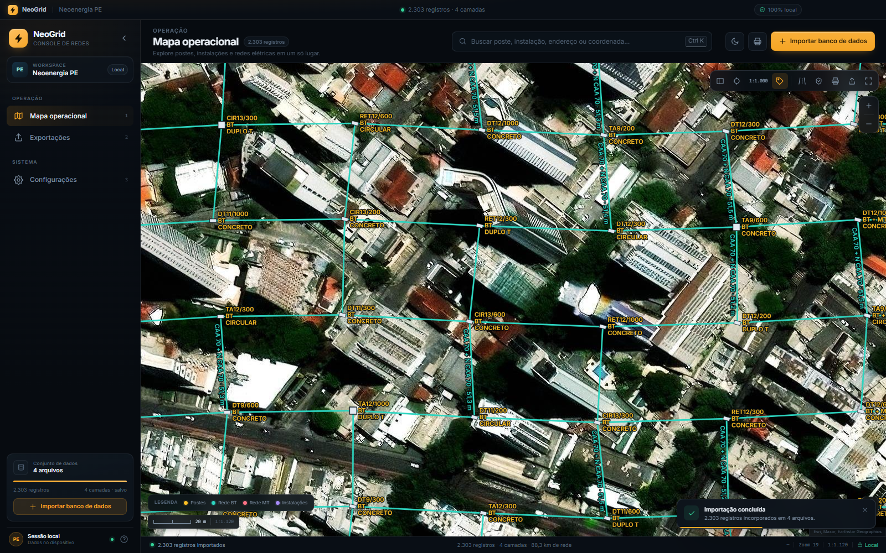

# NeoGrid

Console desktop para operação de redes, postes e ativos elétricos da Neoenergia PE, construído a partir do mapa original `BASE-NEOENERGIA.html`.

A versão 3 une o NeoGrid ao CTWeb: o módulo **Projeto** (edição do desenho, arruamento, anotações) e o **Pacote de Projeto** rodam dentro do app. Veja a seção "Módulo Projeto".

O NeoGrid é um aplicativo **desktop** (Tauri 2 + Rust), não um site. Ele não precisa de servidor, publica nada na internet e processa os CSVs localmente. A interface foi organizada como um workspace profissional: mapa operacional, explorador de dados, exportações e configurações.

Os dados importados ficam persistentes no programa: o NeoGrid salva automaticamente um snapshot local em `%APPDATA%\br.com.neogrid.desktop\projects\autosave.neogrid`. O snapshot usa dicionário por coluna + gzip; em uma base de teste com 2.303 registros, 199,6 KB de JSON viraram aproximadamente 34 KB em disco (83% menor). Também é possível exportar e abrir projetos portáteis `.neogrid`.



---

## 1. Como executar

### Desenvolvimento

```powershell
npm install     # só na primeira vez (CLI do Tauri, usada para o instalador)
npm start
```

`npm start` compila e abre o aplicativo (Tauri). Em modo debug o próprio app
serve o frontend direto de `src/`, então editar HTML/CSS/JS e recarregar
(`Ctrl+R`) basta — sem rebuild. Atalhos úteis:

```powershell
npm run app:release-run   # roda o release (frontend embutido)
npm run core:test         # testes do núcleo Rust
npm run core:parity       # audita adapter x commands x ACL
npm run e2e:projeto -- --port 9222 --db <base.sqlite> --out <pasta>   # módulo Projeto no app real
npm run e2e:print -- --port 9222 --db <base.sqlite> --out <pasta>     # impressão pelo botão do mapa
npm run e2e:busca -- --port 9222 --db <base.sqlite> --out <pasta>     # barra de pesquisa e controles de camadas
npm run test:coord                                                    # interpretação de coordenadas
```

### Instalador para Windows

```powershell
npm run package           # equivale a app:build
npm run app:install       # compila e instala por cima (por usuário, sem admin)
```

Saída:

```
rust/target/x86_64-pc-windows-gnu/release/bundle/nsis/NeoGrid_3.0.0_x64-setup.exe
```

O instalador tem ~7 MB, instala **por usuário** (sem admin) em
`%LOCALAPPDATA%\NeoGrid`, cria atalho no Menu Iniciar e desinstalador, e
depende apenas do **WebView2** (já presente no Windows 10/11). O executável
carrega o frontend embutido — não é preciso instalar Node.js, Electron ou
nenhum servidor.

> O executável não possui assinatura digital comercial. Em máquinas com
> SmartScreen, o Windows pode exibir um aviso na primeira execução; nesse caso,
> use **Mais informações → Executar assim mesmo**.

### Requisitos de build

- Rust (toolchain `x86_64-pc-windows-gnu`) + [w64devkit](https://github.com/skeeto/w64devkit)
  para o linker (com MSVC Build Tools instalado, o alvo `msvc` dispensa o
  w64devkit e o workaround de `resource.lib`). Nada exige administrador.
- NSIS para gerar o instalador.
- Os caminhos são resolvidos por `rust/scripts/env.ps1`: variáveis
  `NEOGRID_W64DEVKIT`, `NEOGRID_NSIS` e `NEOGRID_NODE` ou, por padrão,
  `%LOCALAPPDATA%\neogrid-tools\{w64devkit,nsis,node}`.
- O script de build já trata o caso sem MSVC: converte `resource.lib` com
  `windres` e repete o link.

O shell Electron foi removido na versão 3. O histórico da migração para o Tauri
está em `rust/PARITY.md`, `rust/TAURI.md` e `rust/CUTOVER.md`.

---

## 2. Funcionalidades

### Módulo Projeto

Abra pelo item **Projeto** da barra lateral. O painel fica ao lado do mapa, sem cobri-lo.

1. **Área**: retângulo ou polígono desenhado no mapa. Vale para a base SQLite e para CSVs em memória.
2. **Edição**: mover, girar e editar textos, blocos e linhas; anotações; organizar (alinhar, distribuir, girar); **Anotar poste** (instalar, reaplicar, remover); localizar e substituir; desfazer e refazer. Nada altera a base.
3. **Ruas**: pistas com largura real a partir do OpenStreetMap, ajustadas ao redor dos postes, com ajuste fino de eixo, bordas e vértices. O cálculo roda em segundo plano, sem travar a janela.
4. **Entregar**: gera de uma vez, em `.zip` ou pasta:
   - DXF do projeto com as edições;
   - prancha PDF **vetorial** de A4 a A0 com carimbo, norte e barra de escala, em várias folhas quando a área não cabe na escala (ou ajustada a uma folha);
   - quantitativo da rede existente **mais os serviços anotados** (instalar, reaplicar, remover);
   - dados da área em CSV por camada, GeoJSON, arquivo do projeto (`.neogrid-projeto.json`) e `LEIA-ME.txt`.

   Nas opções recolhidas ficam o DXF R2000 (MTEXT, tipos de linha, blocos com atributos), o quantitativo e o GeoJSON avulsos.

Durante a criação do projeto, um painel mostra cada etapa, o tempo e o servidor em uso, com **Cancelar** e **Continuar sem arruamento**. Projetos `.ctweb.json` do CTWeb também abrem.

### Pacote de ruas offline

Um único arquivo `.neogrid-ruas` com as vias de Pernambuco em ladrilhos: rodovias, ruas, estradas vicinais e rurais, vias de serviço e caminhos, conforme mapeados no OpenStreetMap. Com ele, as áreas abrem sem internet e sem depender dos servidores públicos.

Em **Exportações → Pacote de ruas offline**: baixar e gerar (extrato do Nordeste no Geofabrik, ~445 MB), **importar** um arquivo recebido de um colega ou um `.osm.pbf`, e **exportar para compartilhar**. Fora do app: `neogrid-ruas <extrato.osm.pbf> <saida.neogrid-ruas> [data]`.

Dados de vias © colaboradores do OpenStreetMap, licença ODbL.

### Configuração única

Estilos, regras, blocos e rótulos, inclusive os do KML, ficam em um só lugar (**Estilos**, na barra lateral) e valem para o **mapa inteiro**, para o projeto e para o DXF. Fonte, tamanho, cor, contorno, balão e posição dos rótulos aparecem no mapa, e o projeto aberto se refaz ao mudar um estilo.

As camadas se ligam e desligam pela legenda do mapa, que fica sempre à vista, pelo painel de camadas e pelo painel do Projeto. A legenda também traz **Arruamento** (ruas guardadas no mapa e inclusão no DXF), **KML** e **Rótulos**. No Projeto, desligar uma camada também a tira do DXF, da prancha e do quantitativo. Na primeira abertura, blocos, regras e rótulos configurados em versões anteriores são convertidos.

As edições, estilos e ruas ficam em `workspace.sqlite`, na pasta de dados do app, separado da base: gerar a base do mês seguinte não apaga o trabalho.

### Consultar

Filtro por expressão (mesma linguagem dos rótulos) em qualquer camada, e **SQL somente leitura** na base. As visões `v_poste`, `v_inst`, `v_bt` e `v_mt` já devolvem os valores por extenso e o WKT. Limites: um comando por vez, 60 segundos e 20.000 linhas.

### Regionais e limites

Ao gerar a base, as pastas abaixo da origem viram a coluna `REGIONAL`. A base pode vir de uma **pasta ou de um `.zip`**. No painel de camadas dá para escolher quais regionais aparecem no mapa e entram nas áreas. O painel também traz os limites de Pernambuco e a busca de município (dados do IBGE embutidos), e a barra do mapa ganhou a **medição de distâncias**.

### Mapa operacional
- Renderização em canvas, somente da área visível, com suporte a bases extensas.
- Camadas de **postes**, **rede BT**, **rede MT** e **instalações**.
- Fundos: satélite Esri, ruas Esri, CARTO escuro, CARTO Voyager, OpenStreetMap e sem fundo.
- **Ruas guardadas** como camada de consulta: mostra o que está no pacote de ruas ou já foi baixado, sem acessar a internet.
- **KML** com pontos, linhas, áreas e nomes, com escolha do que aparece e navegação até o arquivo.
- Rótulos com desvio de colisão, priorização e exibição a partir do zoom configurado.
- Construtor de rótulos por camada: escolha os campos de postes, instalações, BT e MT sem digitar modelos; a mesma configuração vale para o mapa e o DXF.
- Substituições de anotação: troque valores ou trechos do rótulo por padrões (ex.: trechos cujo nome contém `LIG` viram `Ligação`).
- Detalhes do ativo em painel lateral, com atributos, vínculos e equipamentos relacionados.
- Painel de camadas recolhível e detalhes sob demanda para manter o mapa limpo.
- Clique em ativos sobrepostos mostra uma lista para escolher o elemento correto.
- Escala calculada em tempo real, barra de escala, norte, tela cheia e transparência do fundo.
- Busca global por ID de poste, instalação ou trecho, barramento (`DE_BARRAMENTO`), placa (`DE_PLACA`), coordenada ou endereço (OSM/Nominatim/Photon). Coordenadas aceitam graus decimais, graus e minutos e UTM no formato do Google Earth (`25M 291443 9108420`). Códigos e coordenadas não vão para os serviços de endereço nas sugestões automáticas. A busca por barramento e placa usa um índice próprio (cerca de 50 MB nos dados do app), gerado sozinho na primeira abertura de cada base, sem alterar a base.

### Importação
- Leitura em **Web Worker** com envio por lotes, evitando travar a interface.
- Detecção automática do tipo de camada pelo nome do arquivo e pelo cabeçalho.
- Detecção de separador (`;`, `,`, tabulação) e codificação (UTF-8, Windows-1252 e UTF-16).
- Combinação de arquivos do mesmo tipo, inclusive quando a ordem ou a quantidade de colunas muda.
- Barra de progresso por arquivo, cancelamento e resumo de importação.
- Aviso quando as coordenadas parecem estar em UTM (o mapa usa WGS 84).

### Base completa em SQLite (milhões de registros)

Para a base completa da Neoenergia PE (~2 GB, 5,6 milhões de registros), o NeoGrid usa um banco SQLite externo em vez de carregar tudo na memória:

1. Gere o banco a cada extração mensal direto no programa: **Importar → Base completa em SQLite → Gerar a partir de CSVs…**, selecione a pasta da extração e onde salvar o `.sqlite`. A conversão roda em segundo plano com progresso, pode ser cancelada, e ao final oferece abrir o banco. Equivale ao comando abaixo, que continua disponível para automação:
   ```powershell
   node scripts/build-sqlite.js "D:\...\BASE EXPORTADA COMPLETA" "D:\...\neogrid_base_completa.sqlite" --manifesto-out manifesto.json
   ```
   O conversor detecta sozinho por arquivo: encoding (BOM, UTF-16, UTF-8, Windows-1252), delimitador (`;`, `,`, TAB), camada (nome + confirmação pelo cabeçalho) e colunas novas. Todo campo é guardado como texto original; linhas malformadas vão para quarentena com número da linha e motivo; colunas repetitivas viram dicionário e WKTs longos são comprimidos — tudo sem perda. Vínculos poste↔instalação/rede são pré-computados. Ao final ele valida as contagens, compara com o manifesto do mês anterior (`--manifesto-base`) e falha sem gerar banco se os rejeitos passarem do limite (`--reject-limit`).
2. No NeoGrid, abra **Importar → Base completa em SQLite → Abrir base .sqlite…**.
3. O mapa consulta o banco **por área visível** (só o que está na tela entra em memória); a busca por ID, a ficha com vinculados e a exportação DXF por área funcionam sob demanda.

Números medidos com a base completa (5.602.772 registros, 70.309 km de rede): ~650 MB de RAM total contra ~16 GB projetados no modo em memória. O modo CSV continua disponível para regionais e bases menores, sem nenhuma mudança.

Limitações do modo banco: o CSV exporta a página atual (para áreas maiores, use o DXF por área) e não há snapshot `.neogrid` (o próprio `.sqlite` é a persistência).

### Persistência e projetos
- Salvamento automático após importações e alterações da base.
- Restauração automática ao abrir o programa.
- Compressão por coluna: valores repetidos (material, tipo, condutor etc.) são armazenados como dicionário + índices binários; geometrias e IDs são preservados integralmente.
- Gzip no snapshot final, com escrita atômica para evitar arquivo parcial após queda de energia.
- Exportação de projeto `.neogrid` para backup ou transferência para outra máquina.
- A opção **Limpar base de dados** remove a memória e o snapshot automático; os CSVs originais permanecem intactos.

### Exportações
- **DXF** pelo módulo Projeto, em UTM/SIRGAS 2000.
- Camadas DXF organizadas: `POSTES`, `INSTALACOES`, `REDE_BT`, `REDE_MT`, textos, arruamento e KML (`KML_PONTOS`, `KML_LINHAS`, `KML_AREAS`, `TXT_KML`).
- Desenho configurável: blocos por tipo de poste e de instalação, formas de fallback, cores ACI por camada e rótulos montados com colunas do CSV. O mapa e o DXF usam a mesma configuração.
- **Ponto de inserção dos blocos**: ponta inferior (padrão do poste), centro, topo, laterais ou o ponto base do próprio bloco. Assim a ponta do poste cai na coordenada do CSV, como no mapa, em vez de o eixo ficar no centro do símbolo.
- **Cor dos blocos**: preto/branco ACI 7 por padrão (o padrão do CAD), com opção de escolher outra cor por tipo ou manter as cores internas do DXF. As cores internas podem ser uniformizadas para BYBLOCK.
- **Regras de blocos por atributos**: uma ou mais condições com `E`/`OU`, operadores de texto e número, ordem de prioridade e contagem de registros que combinam. A primeira regra que combinar escolhe o bloco; por tipo e o bloco padrão ficam como fallback.
- **KML**: importe arquivos, veja pontos/linhas/áreas, escolha o que exibir e inclua os elementos visíveis no DXF.
- **Configuração de blocos portátil**: exporte blocos, regras, cores e rótulos para um `.json` e importe em outra máquina pelo botão **Importar…** do desenho.
- **CSV** por camada, completo (um arquivo por camada).
- **Prancha/PDF** de A4 a A0, paisagem ou retrato, com moldura de área, carimbo, legenda, norte e escala exata. A janela de impressão só abre com a rede e o fundo da folha completos; a impressão não usa os limites de desempenho da tela. Se algo faltar (camada acima de 20.000 elementos, imagens de fundo, escala abaixo de 1:17.800), o app avisa antes de imprimir. Rótulos sobrepostos ou abaixo do zoom mínimo dos estilos ficam de fora, com aviso ao final, ou entram com **Imprimir todos os rótulos**.
- Histórico de exportações da sessão.

### Configurações
- Tema escuro/claro e quatro cores de destaque.
- Densidade compacta.
- Fundo padrão, escala padrão e rótulos.
- Otimização automática do mapa: limita o custo de desenho, usa DPI adaptativo e mantém a fluidez em bases grandes.
- Limites de elementos e rótulos e qualidade do canvas (DPI) em ajustes avançados.
- Restauração de preferências e limpeza da base.

---

## 3. Formato dos CSVs

O app aceita arquivos `.csv` ou `.txt` com cabeçalho. Os nomes são reconhecidos por padrões:

| Arquivo | Tipo | Exemplos |
|---|---|---|
| `postes.csv` | Postes | `POSTE`, `postes_2026.csv` |
| `rede_bt.csv` | Rede BT | `REDE_BT`, `rede-bt.csv` |
| `rede_mt.csv` | Rede MT | `REDE_MT`, `rede_mt.csv` |
| `instalacoes.csv` | Instalações | `INSTALACOES`, `instalações.csv` |

Se o nome não for reconhecido, o tipo é inferido pelas colunas. O usuário também pode corrigir o tipo manualmente antes de importar.

### Coordenadas

O app espera coordenadas geográficas em **WGS 84**:

- colunas `GEO_X` (longitude) e `GEO_Y` (latitude);
- `NU_LONGITUDE` e `NU_LATITUDE`; ou
- coluna `GEOMETRIA_WKT` com `LINESTRING`, `MULTILINESTRING` ou `POINT`.

Para redes, a geometria WKT é a fonte principal para desenho, medição e DXF. Os campos de comprimento `NU_COMPRIMENTO_REAL` ou `SHP_LENGTH` são usados quando disponíveis.

### Colunas reconhecidas

O app é tolerante a nomes ausentes. As principais colunas usadas são:

**Postes:** `NU_PG_ID`, `GEO_X`, `GEO_Y`, `NU_ANGULO`, `NU_ALTURA`, `NU_ESFORCO`, `DE_BARRAMEN`, `MATERIAL`, `TIPO_PG`, `NU_INSTALA`.

**Instalações:** `NU_INSTALA`, `TIPO_INSTA`, `TIPO_SIGLA`, `DE_PLACA`, `NU_PG_ID`, `GEO_X`, `GEO_Y`, `NU_ANGULO`.

**Redes:** `NU_TRECHO`, `NU_PG_INI`, `NU_PG_FIN`, `CONDUTOR_A/B/C/N`, `NU_COMPRIMENTO_REAL`, `SHP_LENGTH`, `CD_FASE`, `GEOMETRIA_WKT`.

Colunas extras são preservadas e aparecem no detalhe do ativo. Campos terminados em `_DESC` são usados como descrição amigável do campo correspondente.

---

## 4. Atalhos

| Atalho | Ação |
|---|---|
| `Ctrl K` | Focar a busca global |
| `Ctrl O` | Abrir importação |
| `Ctrl P` | Abrir compositor de impressão |
| `1` … `3` | Mapa, exportações, configurações |
| `F` | Ir à concentração de dados |
| `S` | Voltar à escala configurada (padrão 1:1000) |
| `+` / `-` | Zoom do mapa |
| `Esc` | Fechar busca/painéis e limpar seleção |

---

## 5. Arquitetura

```
rust/                        aplicativo oficial (Tauri 2 + Rust)
  neogrid-core/              parsing determinístico: encoding, delimitador, headers, WKT, UTM
  neogrid-build/             conversor CSV → SQLite (lib + CLI `neogrid-build`)
  neogrid-query/             leitura do banco (viewport, busca, página, vínculos)
  neogrid-app/               shell Tauri: commands IPC, janela, servidor do frontend
    src/serve.rs             serve `src/` embutido em localhost:<porta efêmera> (ou do disco em dev)
    build.rs                 manifesto ACL dos commands
  parity/                    harness de paridade, E2E via CDP e auditoria de contrato
  scripts/                   env.ps1, build-app.ps1, run-app.ps1, fix-tauri-res.ps1
src/
  index.html                 shell da aplicação
  css/
    tokens.css               design tokens, temas e densidade
    base.css                 reset, tipografia e utilitários
    layout.css               shell, sidebar, topbar, status bar
    components.css           botões, modais, formulários, toasts
    map.css                  workspace do mapa, painel, inspetor
    views.css                exportações, configurações, print
  js/
    main.js                  composição da aplicação e roteamento
    boot.js                  aplica tema antes da primeira pintura
    core/
      desktop-tauri.js       adapter da superfície `window.desktop` no Tauri
    data/
      schema.js              metadados das camadas e detecção de arquivos
      layer-store.js         armazenamento em memória + índice espacial
      sqlite-store.js        camada lida sob demanda do banco SQLite (cache por área)
      database-client.js     cliente das consultas ao banco via IPC
      library.js             agregação das camadas e estatísticas
      labels.js              rótulos de postes/redes/instalações
      geometry.js            parser WKT, geodésia
      csv-export.js          geração e salvamento de CSV
      import-controller.js   orquestração da importação
      workers/csv-worker.js  leitura streaming com PapaParse
    projeto/                 motor do módulo Projeto (scripts clássicos, carregados no primeiro uso)
      00..03                 expressões, DXF, Clipper, geometria das ruas
      10..17                 configuração, estilos, seleção, consulta, limites, arruamento, projeto
      18-pacote.js           Pacote de Projeto e prancha PDF vetorial
      19-integracao.js       eventos do mapa e painéis
    modules/
      projeto/index.js       ponte entre o NeoGrid e o motor (`window.NG`)
      map/                   Leaflet, canvas, basemaps, inspetor
      views/                 exportações, configurações
      dxf/                   UTM, geração DXF, UI de seleção e configuração do desenho
      print.js               compositor e prancha de impressão
    ui/                      toasts, confirmação, diálogos, ficha, construtor de rótulos
  vendor/                    Leaflet, PapaParse, Inter, @tauri-apps/api e licenças
build/                       ícones do aplicativo
```

### Decisões de desempenho

- A importação roda em Web Worker e envia os dados em lotes de 8.000 linhas.
- Cada camada mantém um índice espacial em células de ~1 km (`grid`), usado para renderização e hit-test.
- O canvas desenha apenas os elementos dentro do viewport (com margem) e aplica limite configurável.
- O DPI do canvas acompanha a tela e o modo de otimização (até 1,5× por padrão), evitando custo desnecessário em telas 4K.
- Rótulos e blocos resolvidos são memorizados por versão de configuração e base; o mesmo rótulo não é recalculado a cada quadro.
- A geometria WKT é interpretada sob demanda e armazenada em cache com descarte em blocos, sem limpar toda a memória.
- O conversor CSV → SQLite em Rust é ~1,7× mais rápido que o Node e usa menos memória (base completa em ~4,4 min); as consultas do banco rodam em Rust, com a mesma resposta do backend anterior.

### Limitações atuais

- O NeoGrid mantém a base inteira em memória. A base completa da Neoenergia PE (cerca de **2 GB e 5,6 milhões de registros**) não cabe nesse modelo: importe **uma regional por vez**, com Poste + Rede BT + Rede MT + Instalação. O aplicativo bloqueia seleções acima de ~950 mil registros ou 600 MB.
- O snapshot local é limitado a 700 mil registros. Acima disso o salvamento automático é pausado para evitar travamento; importe uma parte menor para persistir.
- A renderização vetorial usa um canvas único; bases com milhões de elementos devem ser operadas com zoom próximo.
- Fundos de mapa, busca de endereços e arruamento dependem de internet. O modo **Sem fundo** funciona offline.
- Sem o pacote de ruas, o primeiro download de cada área depende dos servidores públicos e pode levar minutos. Eles também podem estar fora do ar. O KML e o arruamento carregados são salvos no navegador/armazenamento local; arquivos muito grandes continuam válidos para a sessão, mas podem não ser persistidos.

---

## 6. Privacidade

- Nenhum CSV é enviado para servidores.
- Não há telemetria, login ou analytics.
- Apenas as requisições de tiles (Esri/CARTO/OSM), geocodificação (Photon/Nominatim) e arruamento (Overpass/OSM) saem do computador, e somente quando esses recursos são usados.
- O KML e o arruamento carregados ficam no armazenamento local do aplicativo; nenhum arquivo é enviado para servidores.
- A aplicação roda em WebView isolado, sem Node.js no frontend: o acesso a
  disco, rede e banco passa só pelos commands do shell Rust, com permissões
  explícitas (`capabilities/default.json`). O `net_fetch_text` aceita apenas os
  9 hosts de mapas/geocodificação/arruamento.

---

## 7. Tecnologias e licenças

- [Tauri](https://tauri.app/) — MIT / Apache-2.0
- [Rust](https://www.rust-lang.org/) + crates: `rusqlite` (SQLite bundled, domínio público), `csv`, `encoding_rs`, `flate2`, `serde`, `tiny_http`, `include_dir`, `rfd`, `ureq`
- [Leaflet](https://leafletjs.com/) — BSD-2-Clause
- [PapaParse](https://www.papaparse.com/) — MIT
- [Inter](https://rsms.me/inter/) — SIL Open Font License 1.1
- [Clipper](http://www.angusj.com/clipper2/) (porte JavaScript, usado no arruamento) — Boost Software License
- [@tauri-apps/api](https://www.npmjs.com/package/@tauri-apps/api) — MIT (vendorizado em `src/vendor/tauri/`)

As licenças dos componentes estão incluídas em `src/vendor/` e nos `Cargo.toml`
do workspace `rust/`.

O arquivo `BASE-NEOENERGIA.html` permanece no repositório como referência da versão original.

> **Distribuição no Windows:** use o instalador
> `NeoGrid_3.0.0_x64-setup.exe` (por usuário, sem admin). Ele instala o
> executável e o `WebView2Loader.dll` juntos; copiar somente o `.exe` fora da
> pasta de instalação não é suportado.

---

## 8. Capturas e exemplo

A pasta `screenshots/` reúne capturas reais da interface:

- [`02-map.png`](screenshots/02-map.png) — mapa com rótulos e camadas
- [`03-map-inspector.png`](screenshots/03-map-inspector.png) — detalhe de um ativo
- [`10-import-dialog.png`](screenshots/10-import-dialog.png) — importação
- [`12-print-panel.png`](screenshots/12-print-panel.png) — compositor de prancha
- [`13-dxf-dock.png`](screenshots/13-dxf-dock.png) - exportação DXF
- [`21-dxf-settings.png`](screenshots/21-dxf-settings.png) - blocos, regras por atributos, cores e rótulos do mapa e do DXF
- [`22-map-blocks.png`](screenshots/22-map-blocks.png) - blocos configurados no mapa
- [`23-labels-dialog.png`](screenshots/23-labels-dialog.png) - construtor de rótulos por camada
- [`25-labels-mt.png`](screenshots/25-labels-mt.png) - campos disponíveis para a Rede MT
- [`26-labels-substitutions.png`](screenshots/26-labels-substitutions.png) - substituições de anotação
- [`24-dxf-rule-editor.png`](screenshots/24-dxf-rule-editor.png) - regras de blocos por atributos
- [`43-dxf-settings-share.png`](screenshots/43-dxf-settings-share.png) - exportar/importar configuração de blocos
- [`08-exports-light.png`](screenshots/08-exports-light.png) — tema claro

O arquivo [`screenshots/exemplo-prancha-a3.pdf`](screenshots/exemplo-prancha-a3.pdf) é uma prancha A3 1:1000 gerada a partir da base de demonstração.

---

NeoGrid 3.0 · Console de redes · Neoenergia PE
